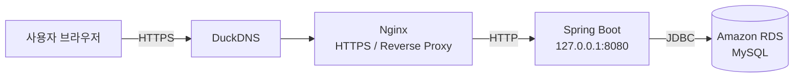
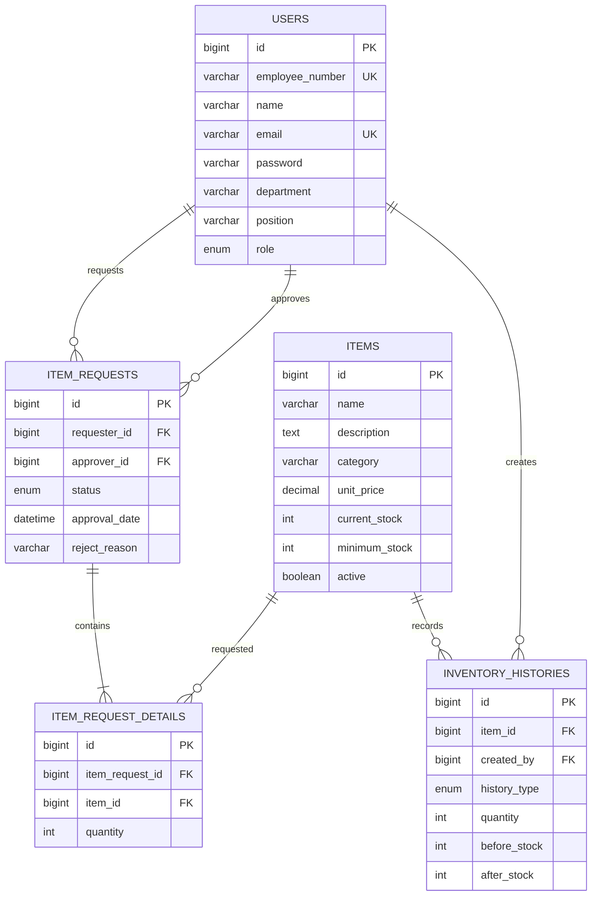
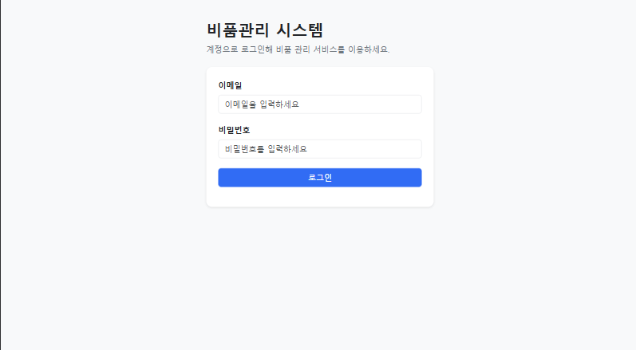
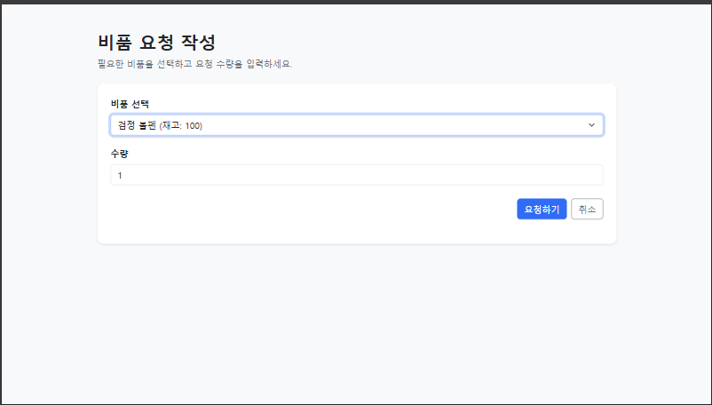
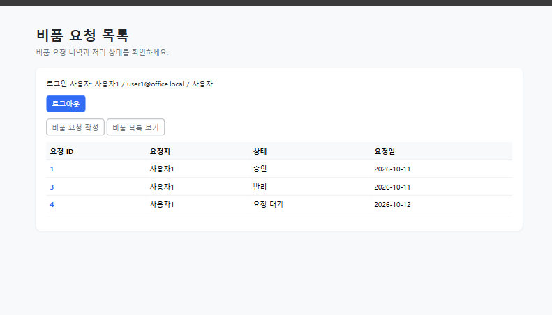
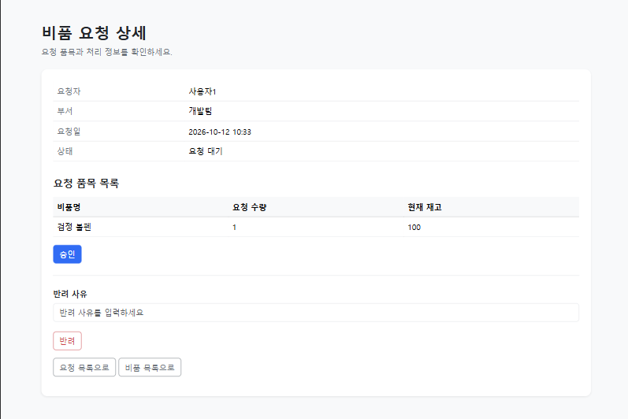
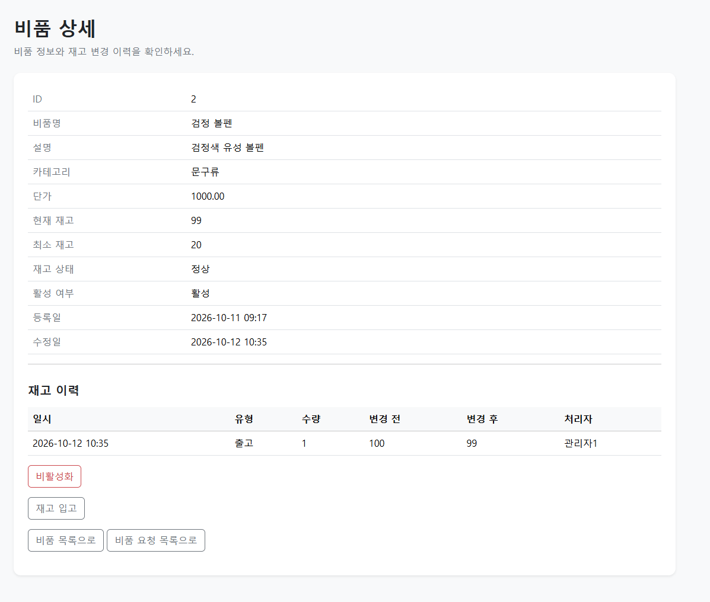

# Office Supplies Management

사내 비품의 재고와 요청·승인 업무를 관리하는 웹 애플리케이션입니다.

사용자는 필요한 비품을 요청하고 처리 상태를 확인할 수 있으며, 관리자는 요청 승인·반려와 재고 입고 및 비품 관리를 수행할 수 있습니다.

<p>
  
  
  
  
  
</p>

<p>
  
  
  
  
  
</p>

## Live Demo

- 서비스: https://officesupplies.duckdns.org
- HTTPS 적용 완료
- 테스트 목적의 데모 서비스이므로 실제 개인정보를 입력하지 마세요.

### 데모 계정

| 권한 | 이메일 | 비밀번호 |
|---|---|---|
| 관리자 | `admin1@office.local` | `OfficeDemoAdmin1&` |
| 사용자 | `user1@office.local` | `OfficeDemoUser1&` |

> 데모 계정의 데이터는 다른 방문자의 테스트로 변경될 수 있습니다.
>  공개 데모 계정은 기능 체험을 위한 계정입니다.  
> 다른 방문자를 위해 기존 데이터를 과도하게 변경하거나 비활성화하지 말아 주세요.

## 주요 기능

### 인증 및 권한 관리

- 이메일 기반 로그인
- BCrypt 비밀번호 암호화
- Spring Security 기반 인증·인가
- `ADMIN`, `USER` 역할별 접근 권한 분리
- 일반 사용자의 관리자 기능 접근 차단

### 비품 관리

- 비품 목록 및 상세 조회
- 비품명, 카테고리, 단가, 현재 재고, 최소 재고 관리
- 관리자 전용 비품 등록 및 비활성화
- 최소 재고 기준 재고 부족 상태 확인

### 재고 관리

- 관리자 재고 입고 처리
- 입고·출고 전후 재고 수량 기록
- 요청 승인 시 재고 자동 차감
- 재고 부족 시 승인 방지
- 재고 변경 이력 추적

### 비품 요청

- 사용자의 비품 요청 생성
- 요청 상태 관리
    - 요청 대기
    - 승인
    - 반려
    - 취소
- 관리자의 요청 승인 및 반려 사유 입력
- 요청자 본인의 대기 요청 취소
- 본인 요청에 대한 관리자 자기 승인 방지
- 사용자별 요청 접근 제어

## 핵심 비즈니스 규칙

- 승인 가능한 요청은 `REQUESTED` 상태여야 합니다.
- 요청자는 자신의 요청을 직접 승인하거나 반려할 수 없습니다.
- 요청자는 본인의 `REQUESTED` 상태 요청만 취소할 수 있습니다.
- 승인된 요청 수량만큼 비품 재고가 차감됩니다.
- 현재 재고보다 많은 수량은 승인할 수 없습니다.
- 승인·반려·취소된 요청은 다시 처리할 수 없습니다.
- 비활성화된 비품은 새 요청 대상으로 사용할 수 없습니다.
- 재고 변경은 입고·출고 이력으로 기록됩니다.

## 기술 스택

| 영역 | 기술 |
|---|---|
| Language | Java 21 |
| Backend | Spring Boot 3.5, Spring MVC |
| Security | Spring Security 6, BCrypt |
| ORM | Spring Data JPA, Hibernate |
| View | Thymeleaf, HTML, CSS |
| Database | MySQL 8, H2 Test Database |
| Test | JUnit 5, AssertJ, Spring Boot Test |
| Build | Gradle |
| Infrastructure | AWS EC2, Amazon RDS |
| Web Server | Nginx |
| HTTPS | Let's Encrypt, Certbot |
| Domain | DuckDNS |
| Process | systemd |

## 시스템 구성



- Nginx가 HTTPS 요청을 받아 Spring Boot 애플리케이션으로 전달합니다.
- Spring Boot는 EC2 내부의 `127.0.0.1:8080`에서만 동작합니다.
- 외부에서는 80·443 포트만 접근할 수 있으며 8080 포트는 공개하지 않습니다.
- RDS는 애플리케이션 서버의 보안 그룹을 통해서만 접근할 수 있습니다.
- 운영 DB 접속 정보는 소스 코드가 아닌 서버 환경변수로 관리합니다.

## ERD



## 테스트

도메인 규칙은 단위 테스트로, 데이터베이스와 서비스 계층의 상호작용은 통합 테스트로 검증했습니다.

주요 검증 항목:

- 비품 재고 증가·차감
- 0 이하 수량 요청 방지
- 보유 재고 초과 차감 방지
- 최소 재고 판정
- 요청 상태 전이
- 요청 승인 시 재고 차감
- 승인 시 출고 이력 생성
- 자기 요청 승인 방지
- 본인 요청 취소
- 타인의 요청 취소 차단

테스트 실행:

```bash
./gradlew test
```

Windows:

```powershell
.\gradlew.bat test
```

## 로컬 실행 방법

### 1. 저장소 복제

```bash
git clone https://github.com/lavven7/office-supplies-management.git
cd office-supplies-management
```

### 2. MySQL 데이터베이스 준비

```sql
CREATE DATABASE office_supplies
    CHARACTER SET utf8mb4
    COLLATE utf8mb4_unicode_ci;
```

### 3. 환경변수 설정

필요한 환경변수:

```text
DB_URL=jdbc:mysql://localhost:3306/office_supplies?serverTimezone=UTC&characterEncoding=UTF-8
DB_USERNAME=데이터베이스_사용자
DB_PASSWORD=데이터베이스_비밀번호
```

### 4. 애플리케이션 실행

```bash
./gradlew bootRun
```

Windows:

```powershell
.\gradlew.bat bootRun
```

브라우저에서 다음 주소로 접속합니다.

```text
http://localhost:8080
```

## 배포 과정에서 해결한 문제

### 운영 DB 연결 실패

애플리케이션 실행 환경에 JDBC URL이 올바르게 전달되지 않아 Hibernate가 Dialect를 결정하지 못하는 문제가 발생했습니다.

- 운영 설정을 `application-prod.properties`로 분리
- DB URL·사용자명·비밀번호를 환경변수로 외부화
- systemd의 `EnvironmentFile`을 통해 운영 환경변수 주입

### Nginx 502 Bad Gateway

Nginx는 실행 중이었지만 Spring Boot 서비스가 RDS 인증 실패로 종료되어 8080 포트에 연결할 수 없었습니다.

- `systemctl status`와 `journalctl`로 서비스 로그 확인
- RDS 접속 정보와 비밀번호 수정
- Spring Boot를 `127.0.0.1:8080`에서 정상 실행
- Nginx 리버스 프록시 연결 확인

### 보안 구성

- EC2의 8080 포트 외부 공개 제거
- SSH는 관리자 IP만 허용
- HTTP·HTTPS만 외부 공개
- RDS는 EC2에서만 접근하도록 보안 그룹 구성
- Let's Encrypt 인증서 적용 및 자동 갱신 설정
- 실제 비밀정보를 Git에서 제외하고 환경변수로 관리

## 향후 개선 사항

- 요청 수정 및 취소 시 비밀번호 재확인
- 다중 품목 일괄 요청
- 요청 목록 검색·필터링·페이징
- 관리자 대시보드 및 재고 부족 알림
- Flyway를 이용한 DB 마이그레이션 관리
- GitHub Actions 기반 CI/CD 자동화
- AWS Secrets Manager 기반 비밀정보 관리
- 사용자 친화적인 오류 페이지 추가

## 화면

### 로그인

<p align="center">
  
</p>

### 비품 요청 작성

<p align="center">
  
</p>

### 요청 생성 및 상태 확인

<p align="center">
  
</p>

### 관리자 요청 승인·반려

<p align="center">
  
</p>

### 비품 상세 및 재고 변경 이력

<p align="center">
  
</p>